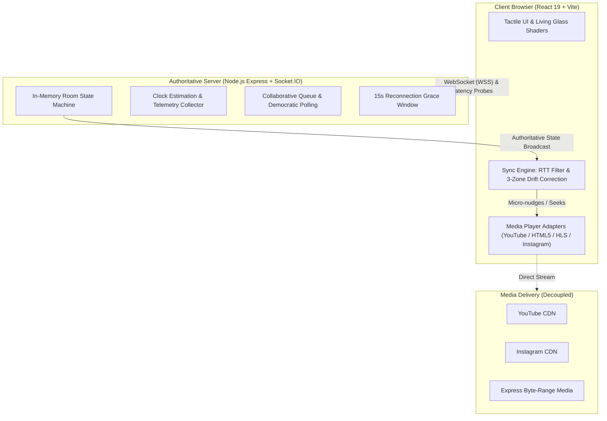

<p align="center">
  
</p>

<p align="center">
  <a href="https://afterglow-watchparty.onrender.com"></a>
  
  
  
</p>

---

**Afterglow** is an ultra-low-latency, real-time synchronized watch party platform engineered for seamless viewing across heterogeneous networks and devices. Built on top of an authoritative WebSocket server and custom client-side drift compensation algorithms, Afterglow eliminates playback divergence without requiring browser extensions, third-party accounts, or software installation.

From high-bitrate movies to YouTube videos and Instagram Reels, friends can watch together in synchronized lockstep with interactive sentiment reactions, collaborative queues, and tactile controls.

---

## ⚡ Try It Instantly

The production deployment is hosted live on Render and is accessible across any public network:

### 👉 **[https://afterglow-watchparty.onrender.com](https://afterglow-watchparty.onrender.com)**

> **Zero friction**: Open the link on any device — laptop, iPad, iPhone (Safari), or Android (Chrome). No downloads, no sign-ups, no tracking.

### 30-Second Walkthrough
1. **Choose an Identity**: Enter your display name and pick your personal signal color.
2. **Create or Join a Room**: Click **Start a room** and paste any supported media URL, or tap a quick-start sample (YouTube, Instagram Reel, or open-source film).
3. **Invite Friends**: Click the **INVITE** button in the top navigation bar to copy your unique room URL.
4. **Watch Together**: Playback commands, seeking, volume synchronization, reactions, and queue voting synchronize instantly across all connected participants.

---

## 📱 Cross-Platform Experience

Afterglow is designed mobile-first and responsive-first. The user interface automatically adapts its chassis, layout, and control schemes based on viewport constraints and media aspect ratios:

<table align="center" width="100%">
  <tr>
    <th width="65%" align="center"><b>Desktop Cinema Control Room</b></th>
    <th width="35%" align="center"><b>Mobile Instagram Reels Chassis</b></th>
  </tr>
  <tr>
    <td align="center" valign="top">
      
      <p align="left"><em>Widescreen cinema mode featuring the Apple Dynamic Island live status pill (with round-trip latency telemetry), liquid glass spotlight projection, reaction heatmap seekbar, live chat drawer, and tactile hardware transport.</em></p>
    </td>
    <td align="center" valign="top">
      
      <p align="left"><em>Mobile 9:16 vertical chassis optimized for Instagram Reels. Features synchronized 3-2-1 host countdown, live floating reactions, and single-tap Instagram app launch.</em></p>
    </td>
  </tr>
  <tr>
    <th width="65%" align="center"><b>Offline-First Film Discovery &amp; Catalog</b></th>
    <th width="35%" align="center"><b>Ambient Control Room Dashboard</b></th>
  </tr>
  <tr>
    <td align="center" valign="top">
      
      <p align="left"><em>Curated discovery catalog with category tags, fuzzy typo-tolerant search, local library status, and quick-pick samples for immediate room creation.</em></p>
    </td>
    <td align="center" valign="top">
      
      <p align="left"><em>Calm, tactile control room lobby showing active server status, reconnection grace parameters, and live theme switcher.</em></p>
    </td>
  </tr>
</table>

---

## 🎬 Supported Media Engines

Afterglow decouples room state coordination from media delivery. Each participant's browser renders media independently, while the server coordinates authoritative timing:

| Provider | Mechanism | Synchronization Behavior |
| :--- | :--- | :--- |
| **YouTube** | Official YouTube IFrame Player API | Bidirectional sync for play, pause, buffer, and seek events with iframe autoplay policy management. |
| **Instagram Reels** | Dedicated 9:16 Embedded Chassis | Synchronized 3-2-1 countdown, live floating emoji reactions, and personal micro-nudge clock adjustment. |
| **Direct MP4 / WebM** | HTML5 `<video>` with Byte-Range Requests | Full client-side rate nudging ($0.95\times$–$1.05\times$) and discrete seeking against an authoritative clock. |
| **Adaptive Streaming (HLS)** | `hls.js` with Native Fallback | Multi-bitrate live or VOD streams with CORS verification and automatic recovery from media network errors. |
| **Commercial Streaming Services** | Honest Sync-Only Clock Engine | For Netflix, Disney+, and Prime Video: synchronizes a shared countdown, clock, and ready check without violating DRM or terms of service. |
| **Screen Sharing** | LiveKit WebRTC Screen Video Relay | Optional video-only screen sharing with scoped one-use ticket validation and graceful fallback when unconfigured. |

---

## 🧠 Engineering & Technical Architecture



### 1. Clock Synchronization & Drift Correction
* **NTP-Style Clock Offset Estimation**: Measures client-to-server latency using high-resolution timestamps. High-RTT outliers and incomplete network round-trips are discarded, maintaining median clock offsets within milliseconds.
* **Three-Tier Drift Correction Engine**:
  * **Band 1: In Tolerance ($\le 150\text{ ms}$)**: Playback proceeds normally; no intervention is made to preserve audio pitch.
  * **Band 2: Micro-Drift ($150\text{ ms} - 1500\text{ ms}$)**: Playback rate is smoothly nudged between $0.95\times$ and $1.05\times$ to seamlessly glide the local playhead back into lockstep without jarring skips.
  * **Band 3: Hard Divergence ($> 1500\text{ ms}$)**: Immediate discrete seek to the authoritative server position.
* **Loopback & Cloud Benchmarks**: Automated Playwright multi-client tests observe maximum drift $\le 38.6\text{ ms}$ under local conditions and $< 250\text{ ms}$ p95 propagation across public cloud deployments.

### 2. Room Governance & Network Resilience
* **15-Second Reconnect Grace Window**: If a host or participant experiences a temporary network drop (e.g. mobile cell tower handover or Wi-Fi reconnect), their session and host permissions are preserved for 15 seconds. If the grace period expires, room ownership gracefully transfers to the next online member.
* **Timeline Reaction Heatmap**: Ephemeral emoji reactions (✨, ♥, ⚡, 👏, 😂) are stamped against the video timeline and aggregated into a live visual heatmap over the seekbar, summarizing crowd reaction peaks upon playback completion.
* **Democratic Polling & Collaborative Queue**: Participants can create custom polls with embedded media links. Winning poll items are automatically added to the room queue, where members upvote selections to determine the next synchronized film.

### 3. Tactile "Living Glass" UI Design
* Built following modern design principles inspired by Apple's Dynamic Island and tactile hardware interfaces.
* **Dynamic Island Status Pill**: Features a pulsing phosphor LED indicator, live round-trip latency counter, and tactile hover-squish dynamics.
* **OLED-Optimized Colorways**: Persistent selection between three distinct palettes:
  * 🌿 **Moss Glow** (Vivid emerald accents with deep forest backdrops)
  * 🏮 **Amber Lamp** (Warm golden amber with low-light cinematic tones)
  * 🌌 **Blue Hour** (Deep midnight blues with electric cyan illumination)

---

## 🛠️ Local Installation & Development

### Prerequisites
* **Node.js**: `20.19+` or `22.12+`
* **npm**: `10+`

### 1. Clone & Install
```powershell
git clone https://github.com/tezz-e/watchparty.git
cd watchparty
npm.cmd install
```

### 2. Run Test Suite
```powershell
# Run the 50-spec Node.js unit and integration test suite
npm.cmd test

# Run the Playwright multi-browser end-to-end synchronization test
npm.cmd run test:browser
```

### 3. Run Development Servers
```powershell
# In terminal 1: Start the backend room & socket server (port 3001)
npm.cmd run server

# In terminal 2: Start Vite client with hot module replacement (port 5173)
npm.cmd run dev
```
Open `http://localhost:5173` in your browser.

---

## 🌐 Multi-Device LAN & Cloud Hosting

### Same-Wi-Fi (LAN) Hosting
To host a party for family and friends on the same local network:
```powershell
# Build production bundle and launch single-origin server
npm.cmd run build
npm.cmd run server
```
Find your machine's local IPv4 address:
```powershell
Get-NetIPAddress -AddressFamily IPv4 | Where-Object { $_.IPAddress -notlike '127.*' -and $_.IPAddress -notlike '169.254.*' }
```
Open `http://<your-ip>:3001` on your computer and guest phones/tablets. Invite links automatically rewrite `localhost` to the host's reachable LAN IP.

### Cloud Deployment (Render / Docker)
The application includes pre-configured configurations for modern cloud platforms:
* **[render.yaml](./render.yaml)**: Automatic zero-config deployment to Render Web Services with WebSockets enabled and `trust proxy` configured.
* **[Dockerfile](./Dockerfile)**: Multi-stage lightweight production image.
* **Environment Variables**:
  * `PORT`: Server listen port (default `3001`).
  * `AFTERGLOW_PUBLIC_URL`: Canonical public HTTPS URL for generating invite links behind reverse proxies.
  * `RECONNECT_GRACE_MS`: Member reconnect grace duration (default `15000` ms).

---

## 🧪 Verification & Automated Coverage

The repository enforces complete regression protection across networking, media providers, and browser behavior:

```text
✔ configured public origin takes precedence and ignores URL paths
✔ localhost origins are rewritten to an active LAN IPv4 while retaining the port
✔ YouTube URL detection supports watch, short, shorts, embed, and live links
✔ Instagram Reel URL detection supports reel, reels, p, and tv links
✔ URL auto-detection selects HLS and recognized streaming services only
✔ clock offset estimation accounts for client and server processing time
✔ playback correction classifies the three drift zones and boundaries
✔ ten clients receive authoritative playback commands and server records delivery
✔ late joiners receive the canonical playhead and queue picks synchronize
✔ reconnect within grace retains host identity; expiry elects next participant
✔ custom polls support changeable votes, host closure, and winner queuing
✔ reaction heatmap records media positions and telemetry sync-health panel
✔ sync-only rooms require a ready check, host countdown, and host clock control
ℹ tests 50 | pass 50 | fail 0
```

Detailed test conditions, loopback limits, and performance data are documented in [TESTING.md](./TESTING.md) and [docs/PERFORMANCE.md](./docs/PERFORMANCE.md).

---

## 📂 Project Structure

```text
afterglow/
├── assets/                  # High-resolution showcase screenshots and vector logo
├── docs/                    # Technical specs, cloud deployment guide, performance logs
│   ├── DEPLOYMENT.md        # Cloud deployment guide (Render, Railway, Docker)
│   └── PERFORMANCE.md       # Latency percentiles and drift benchmarks
├── media/                   # Local media library for byte-range streaming
├── public/                  # Static assets and offline film posters
├── scripts/
│   ├── capture-screenshots.js # Automated Playwright showcase capture utility
│   ├── verify-cloud.js      # Multi-client public cloud verification script
│   └── seed-catalog.js      # Offline film catalog generation
├── server/                  # Core backend modules
│   ├── clock.js             # NTP-style timestamping and drift calculation
│   ├── library.js           # Byte-range HTTP 206 streaming server
│   ├── livekit.js           # WebRTC ticket issuing and token authorization
│   └── rooms.js             # Authoritative room state machine
├── shared/                  # Shared validation rules and media URL parsers
├── src/                     # React 19 Frontend
│   ├── components/          # Living glass UI, room chassis, players, and modals
│   ├── data/                # Offline catalog snapshot
│   └── styles.css           # Tactile design system, theme tokens, and shaders
├── tests/                   # Automated unit, integration, and browser test specs
├── Dockerfile               # Production container definition
├── render.yaml              # Render cloud blueprint
└── server.js                # Express + Socket.IO production entrypoint
```

---

## 📄 License & Attribution

* Built with React 19, Vite, Socket.IO, Express, and Playwright.
* Open-movie posters and metadata powered by [The Movie Database (TMDB)](https://www.themoviedb.org) and [JustWatch](https://www.justwatch.com).
* Distributed under the MIT License. See [CREDITS.md](./CREDITS.md) for media licenses.
