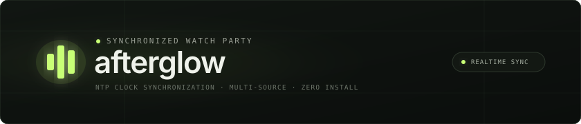
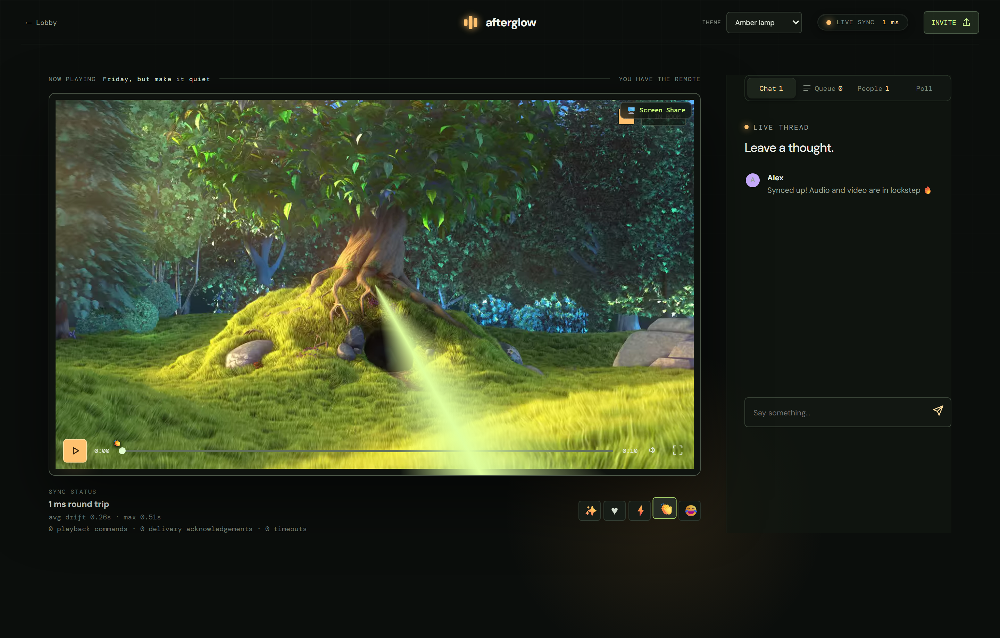
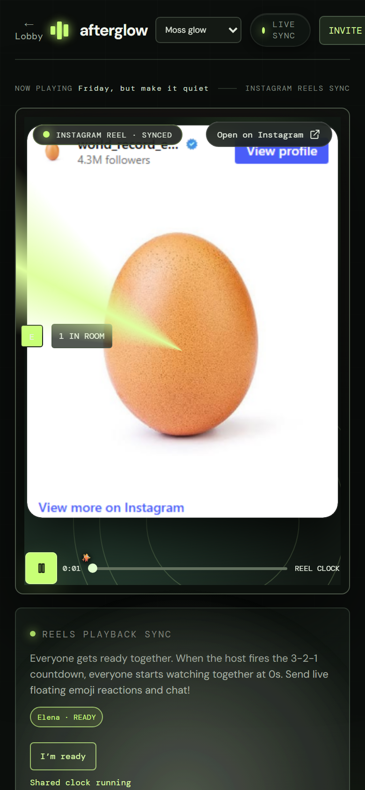
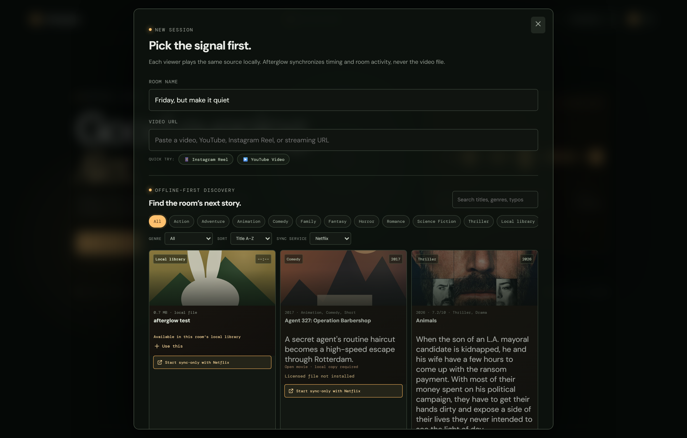
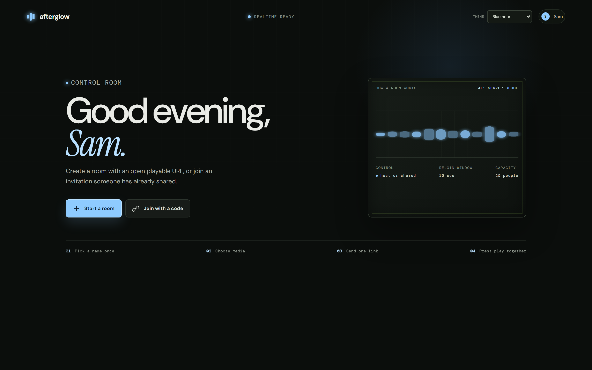

<p align="center">
  
</p>

<p align="center">
  <a href="https://afterglow-watchparty.onrender.com"></a>
  
  
  
</p>

---

**afterglow** is a real-time playback synchronization engine and watch party interface built for multi-network viewing across modern web browsers. Built on an authoritative WebSocket server and client-side drift compensation algorithms, afterglow maintains frame-consistent playback across heterogeneous devices without browser extensions, accounts, or native installations.

The platform coordinates shared rooms for direct video streams (MP4/WebM byte-ranges), adaptive HLS, YouTube, and mobile-optimized Instagram Reels sessions, alongside an honest sync-only countdown protocol for commercial streaming providers.

---

## Live Deployment

The service is deployed and publicly accessible:

**[https://afterglow-watchparty.onrender.com](https://afterglow-watchparty.onrender.com)**

* **Zero configuration**: Runs in any modern desktop, tablet, or mobile browser (iOS Safari, Android Chrome, Chromium, Firefox, WebKit).
* **Privacy-preserving**: No user accounts, credentials, or tracking cookies. Presence is managed through ephemeral in-memory sessions.

### Walkthrough
1. **Set Presence**: Choose a display name and signal color on the identity screen.
2. **Create Room**: Select **Start a room** and input a media URL, or pick from the sample presets (YouTube, Instagram Reel, or open-source film).
3. **Invite Participants**: Use the **Invite** button in the navigation bar to copy the unique room link.
4. **Synchronized Playback**: Play, pause, seek, volume adjustments, timeline reactions, and queue voting propagate authoritatively to all room members.

---

## Cross-Platform Interface

The interface uses responsive layout adapters and custom media viewports tailored to device constraints and content aspect ratios:

<table align="center" width="100%">
  <tr>
    <th width="65%" align="center"><b>Desktop Cinema Control Room</b></th>
    <th width="35%" align="center"><b>Mobile Instagram Reels Chassis</b></th>
  </tr>
  <tr>
    <td align="center" valign="top">
      
      <p align="left"><em>Widescreen cinema mode featuring real-time route latency telemetry in the status pill, reaction heatmap seekbar, live chat drawer, and tactile playback transport.</em></p>
    </td>
    <td align="center" valign="top">
      
      <p align="left"><em>Vertical 9:16 mobile chassis with synchronized 3-2-1 countdown sequence, live floating emoji reaction stream, and native Instagram launch actions.</em></p>
    </td>
  </tr>
  <tr>
    <th width="65%" align="center"><b>Offline-First Film Discovery &amp; Catalog</b></th>
    <th width="35%" align="center"><b>Control Room Dashboard</b></th>
  </tr>
  <tr>
    <td align="center" valign="top">
      
      <p align="left"><em>Curated discovery catalog with category filtering, typo-tolerant search, local library status, and quick-start sample presets.</em></p>
    </td>
    <td align="center" valign="top">
      
      <p align="left"><em>OLED-optimized control room interface displaying active server state, reconnection parameters, and persistent theme controls.</em></p>
    </td>
  </tr>
</table>

---

## Supported Media Providers

Room timing and media delivery are decoupled. Each viewer's browser renders media independently, while the server coordinates authoritative state and playhead timing:

| Provider | Mechanism | Synchronization Model |
| :--- | :--- | :--- |
| **YouTube** | Official YouTube IFrame Player API | Bidirectional sync for play, pause, buffer, and seek states with autoplay policy recovery. |
| **Instagram Reels** | Dedicated 9:16 Embedded Chassis | Coordinated 3-2-1 host countdown, live floating reactions, and personal micro-nudge clock trim. |
| **Direct MP4 / WebM** | HTML5 `<video>` with Byte-Range Requests | Client-side playback rate adjustments ($0.95\times$–$1.05\times$) and discrete seeking against the server clock. |
| **Adaptive Streaming (HLS)** | `hls.js` with Native Fallback | Multi-bitrate VOD and live streams with CORS checking and network error recovery. |
| **Commercial Streaming Services** | Sync-Only Protocol Engine | For Netflix, Disney+, and Prime Video: synchronizes a shared countdown, clock, and readiness check without capturing DRM-protected frames. |
| **Screen Sharing** | LiveKit WebRTC Screen Video Relay | Optional video-only screen sharing with scoped single-use ticket validation and graceful fallback when unconfigured. |

---

## Technical Architecture & Synchronization Engine


### 1. Clock Estimation & Drift Correction
* **NTP-Style Clock Offset Estimation**: Calculates client-to-server clock offset using round-trip timestamp exchanges. High-RTT outliers are filtered using a low-median window.
* **Three-Band Drift Correction**:
  * **Band 1: Tolerance Threshold ($\le 150\text{ ms}$)**: Playback continues uninhibited to prevent audio pitch artifacts.
  * **Band 2: Micro-Drift Correction ($150\text{ ms} - 1500\text{ ms}$)**: Playback rate is smoothly nudged between $0.95\times$ and $1.05\times$ until the local playhead converges on the authoritative clock.
  * **Band 3: Hard Resynchronization ($> 1500\text{ ms}$)**: Immediate discrete seek to the server timestamp.
* **Observed Accuracy**: Automated Playwright end-to-end tests measure maximum observed drift below $39\text{ ms}$ in local environments and below $250\text{ ms}$ p95 propagation over public cloud networks.

### 2. Room State & Network Resilience
* **15-Second Reconnect Grace Window**: Preserves user identity and host privileges during transient mobile network handovers. Host authority migrates to the next online participant only after the grace window expires.
* **Timeline Reaction Heatmap**: Emoji reaction events are recorded with fractional media timestamps and aggregated into a seekbar density map, summarizing engagement peaks.
* **Democratic Polling & Queue Automation**: Room participants can vote on media choices via custom polls; winning items automatically promote to the shared queue.

### 3. Tactile Design System
* Designed around physical control room instruments and OLED display ergonomics.
* **Status Pill**: Houses the real-time latency readout with a subtle phosphor glow indicator.
* **Three Persistent Colorways**:
  * **Moss Glow** (Emerald phosphor accents on muted dark charcoal)
  * **Amber Lamp** (Warm golden amber for low-light cinematic sessions)
  * **Blue Hour** (Deep midnight blues with cyan indicator lights)

---

## Local Development

### Prerequisites
* **Node.js**: `20.19+` or `22.12+`
* **npm**: `10+`

### 1. Setup & Testing
```powershell
git clone https://github.com/tezz-e/watchparty.git
cd watchparty
npm.cmd install
npm.cmd test
npm.cmd run test:browser
```

### 2. Development Servers
```powershell
# Terminal 1: Backend room server (port 3001)
npm.cmd run server

# Terminal 2: Vite development server with HMR (port 5173)
npm.cmd run dev
```

---

## Deployment & Networking

### Local Network (Same-Wi-Fi)
To host a session on your local network:
```powershell
npm.cmd run build
npm.cmd run server
```
Invite links automatically rewrite `localhost` to the host machine's reachable local IPv4 address.

### Cloud Deployment (Render / Docker)
The repository contains native deployment definitions:
* **[render.yaml](./render.yaml)**: Blueprint for Render Web Services with WebSockets enabled and proxy headers trusted.
* **[Dockerfile](./Dockerfile)**: Production multi-stage container build.
* **Key Configuration**:
  * `PORT`: Listening port (default `3001`).
  * `AFTERGLOW_PUBLIC_URL`: Canonical public HTTPS URL for generating external invite links.
  * `RECONNECT_GRACE_MS`: Disconnect grace timeout in milliseconds (default `15000`).

---

## Automated Test Suite

Complete test coverage spans clock synchronization, provider parsing, and room state transitions:

```text
✔ configured public origin takes precedence and ignores URL paths
✔ localhost origins are rewritten to an active LAN IPv4 while retaining the port
✔ YouTube URL detection supports watch, short, shorts, embed, and live links
✔ Instagram Reel URL detection supports reel, reels, p, and tv links
✔ URL auto-detection selects HLS and recognized streaming services only
✔ clock offset estimation accounts for client and server processing time
✔ playback correction classifies the three drift zones and boundaries
✔ ten clients receive authoritative playback commands and server records delivery
✔ late joiners receive the canonical playhead and queue picks synchronize
✔ reconnect within grace retains host identity; expiry elects next participant
✔ custom polls support changeable votes, host closure, and winner queuing
✔ reaction heatmap records media positions and telemetry sync-health panel
✔ sync-only rooms require a ready check, host countdown, and host clock control
ℹ tests 50 | pass 50 | fail 0
```

Detailed test methodology and loopback benchmark records are maintained in [TESTING.md](./TESTING.md) and [docs/PERFORMANCE.md](./docs/PERFORMANCE.md).

---

## Project Structure

```text
afterglow/
├── assets/                  # Interface showcase captures and vector branding
├── docs/                    # Technical specifications, benchmarks, and deployment
│   ├── DEPLOYMENT.md        # Cloud deployment guide (Render, Railway, Docker)
│   └── PERFORMANCE.md       # Latency percentiles and drift benchmarks
├── media/                   # Local media library for byte-range streaming
├── public/                  # Static assets and offline film posters
├── scripts/
│   ├── capture-screenshots.js # Automated Playwright capture utility
│   ├── verify-cloud.js      # Public cloud synchronization verifier
│   └── seed-catalog.js      # Offline film catalog generation
├── server/                  # Backend implementation
│   ├── clock.js             # NTP-style timestamping and drift calculation
│   ├── library.js           # Byte-range HTTP 206 streaming server
│   ├── livekit.js           # WebRTC ticket issuing and token authorization
│   └── rooms.js             # Authoritative room state machine
├── shared/                  # Shared URL parsers and validation schemas
├── src/                     # React 19 Client
│   ├── components/          # Room chassis, media adapters, and modals
│   ├── data/                # Offline catalog records
│   └── styles.css           # Design tokens, theme variables, and shaders
├── tests/                   # Automated unit, integration, and browser test specs
├── Dockerfile               # Production container definition
├── render.yaml              # Cloud deployment blueprint
└── server.js                # Express + Socket.IO production entrypoint
```

---

## Attribution & License

* Developed with React 19, Vite, Socket.IO, Express, and Playwright.
* Open-movie posters and metadata provided by [The Movie Database (TMDB)](https://www.themoviedb.org) and [JustWatch](https://www.justwatch.com).
* Distributed under the MIT License. See [CREDITS.md](./CREDITS.md) for full licensing terms.
